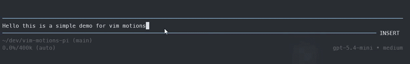

# vim-motions-pi

[](https://www.npmjs.com/package/vim-motions-pi)

A focused Vim-style editing layer for [pi](https://pi.dev): fast motions, text objects, visual selections, and optional clipboard sync.

It brings the essential Vim editing loop into pi without the full Vim complexity.

## At a glance

Edit faster inside pi, with the Vim commands people actually reach for.

- Move with `h j k l`, `w b e`, `0 ^ $`, and `gg G`
- Change text with `dw`, `ciw`, `dd`, `yy`, `p`, `u`, and `r<char>`
- Select with `v` / `V`, then yank, delete, or paste
- Target regions with text objects like `iw`, `aw`, `ip`, and `ap`
- Mirror yank/delete/change operations to the system clipboard when enabled

## Quick demo



## Install

Install with pi:

```bash
pi install npm:vim-motions-pi
```

Or try it for the current run only:

```bash
pi -e npm:vim-motions-pi
```

## Local development / test

Run the extension directly from this repo:

```bash
pi -e ./extensions/vim-motion.ts
```

## What it supports

### Modes
- `insert`
- `normal`
- `visual`
- `visual-line`

### Core motions
- Character motions: `h j k l`
- Word motions: `w b e`
- Line motions: `0 ^ $`
- Buffer motions: `gg G`
- Find motions: `f F t T`
- Repeat find: `;` and `,`

In insert mode, the focused cursor is a real terminal bar, both at the end of a line and over text. Normal mode defaults to a block. All four modes have configurable cursor shapes; text underneath is never replaced.

### Editing actions
- Operators: `d y c`
- Motion-based edits: `dw`, `yw`, `cw`, `d$`, `y^`, etc.
- Linewise forms: `dd`, `yy`, `cc`, `D`, `C`, `S`
- Direct helpers: `x`, `X`, `p`, `P`, `u`, `r<char>`, `o`, `O`, `J`, `i`, `I`, `a`, `A`

### Selection
- `v` enters visual mode
- `V` enters visual-line mode
- Visual selections support `y`, `d`, and `p`

### Text objects
- `iw`, `aw`
- `iW`, `aW`
- `i"`, `a"`
- `ip`, `ap`
- Works with operators, for example: `diw`, `yaw`, `ciW`, `ci"`, `dap`

### Counts
- Prefix counts are supported for motions and many commands
- Examples: `3w`, `2dd`, `5x`, `4G`

## Visual mode notes
- `o` swaps the visual selection ends.
- `v` exits visual mode.
- `V` switches to visual-line mode.
- `p` / `P` replace the selection with the current register contents.

## Register behavior
- Yanks, deletes, and changes go to a single unnamed register.
- `p` and `P` paste from that register.
- Linewise operations keep line breaks when that makes sense.

## Settings inside pi

Run `/vim-settings` to change settings without restarting:

- Escape sequence: 2–32 printable ASCII characters (case-sensitive), or empty to disable.
- Escape timeout: 1–60000 ms between consecutive keys.
- Cursor style independently for Insert, Normal, Visual, and Visual-line modes: `block`, `bar`, or `underline`.
- Clipboard sync: off, yank only, or all operations.
- Clipboard command: custom executable and whitespace-separated arguments, or empty for OS auto-detection. Commands are not run through a shell.

Changes apply immediately and are saved in `~/.pi/agent/vim-motions.json` (or `$PI_CODING_AGENT_DIR/vim-motions.json`). Saved values override environment variables; unset values still use environment defaults. `/vim-clipboard` remains available and saves to the same file. Escape cancels the current dialog; edits already saved remain in effect.

Cursor styles use the real terminal cursor (DECSCUSR): `bar` stays a vertical bar everywhere, `block` stays a block, and `underline` stays an underline. Your terminal must support cursor-shape escape sequences. Pi's fake cursor decoration is removed without replacing any text. When the editor loses focus or the session shuts down, hardware-cursor visibility is restored and the shape resets to the terminal default. Older Pi hosts without hardware-cursor control retain their default cursor. Selection highlighting remains separate from cursor shape.

If the settings file is malformed, pi warns and uses defaults; fix the file before saving further changes so the original file is not silently overwritten.

## Optional clipboard sync
Keep the unnamed register in sync with your system clipboard.

Open `/vim-settings` and choose **Clipboard sync**:

- **Off** (`off`): disable clipboard sync.
- **Yank only** (`yank`): sync only yank operations.
- **All operations** (`all`): sync yank, delete, and change operations.

The choice takes effect immediately and is saved for future sessions. `/vim-clipboard` is a backward-compatible shortcut to the same setting, not a separate configuration.

For shell-based configuration, `VIM_MOTION_PI_CLIPBOARD=off|all|yank` is still supported as a default when no saved clipboard setting exists.

When enabled, the extension uses the usual clipboard command on your OS (`pbcopy`, `clip`, `wl-copy`, `xclip`, or `xsel`) if available.

### Custom clipboard command

In `/vim-settings`, choose **Clipboard command** and enter a command such as `my-clipboard-tool --copy`. Leave it empty to restore OS auto-detection, including when an environment override is set.

Alternatively, set an environment default:

```bash
VIM_MOTION_PI_CLIPBOARD_COMMAND="my-clipboard-tool --copy"
```

The value is split on whitespace; the first word is the command and the rest are arguments. The selected text is passed via stdin.

This is useful inside tmux/SSH sessions where `wl-copy` or `xclip` may not work, and you want to route clipboard through OSC 52 or another transport.

## Custom escape sequence

By default only `Esc` leaves insert mode. Open `/vim-settings` and choose **Escape sequence** to enable a sequence. Letters do not have to differ, and symbols are supported: `jk`, `jj`, `//`, `''`, and `'/` are all valid. Enter the sequence directly without wrapping it in quotes. An empty value disables it.

Choose **Escape timeout** in the same menu to set the maximum interval between consecutive keys. The default is **100 ms**, which is quite strict; try **300–500 ms** if ordinary typing does not trigger the sequence. Confirm the new value appears in the settings menu. Changes apply immediately without restarting.

Environment defaults remain available for settings that have not been saved:

```bash
VIM_MOTION_PI_ESCAPE_SEQUENCE=jk
VIM_MOTION_PI_ESCAPE_TIMEOUT_MS=300
```

- The sequence must contain 2–32 printable ASCII characters.
- Keys are inserted instantly as you type. When the sequence completes within the window (default 100 ms), the already-typed sequence characters are deleted and the editor returns to normal mode.
- If the next key arrives after the window or is a different key, the already-inserted text remains. Pressing a real `Esc` also keeps that text and exits insert mode.
- Tune the window with `VIM_MOTION_PI_ESCAPE_TIMEOUT_MS` (e.g. `50` for a tighter escape, `300` for more slack).
- Only consecutive single printable keystrokes feed the matcher. Pasted text, arrow keys, Backspace, and other control input pass through unchanged and cancel any pending sequence prefix.

## Examples

```text
3w      move forward 3 words
ciw     change inner word
daw     delete around word
yy      yank current line
p       paste yanked text
f,      find the next comma
;       repeat the last find
```

## Limitations

This is a Vim-like subset, not full Vim.

It only affects the text input/editor area inside pi, not the whole app.

In insert mode, most keys pass through to pi directly, except `Esc`, which returns to normal mode.

In normal / visual modes, some pi hotkeys may be intercepted by Vim-style key handling.

Not supported:
- search with `/` or `?`
- macros
- marks
- dot-repeat (`.`)
- multiple named registers

## Uninstall

```bash
pi remove npm:vim-motions-pi
```

## Source

- GitHub: https://github.com/kepatrick/vim-motions-pi
- Source lives in `extensions/vim-motion.ts`
